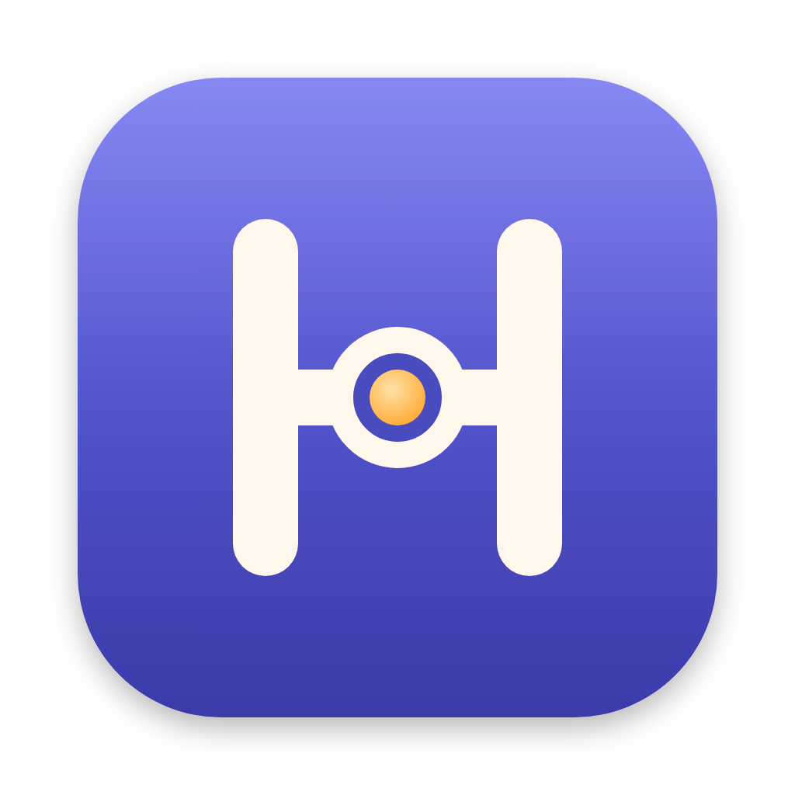

<p align="center"></p>

# Harnette

A desktop control plane for AI coding agents. You write the ticket, an analyst agent writes the plan, an implementer
changes the code, a reviewer checks it, and you stay in charge of every step. Runs on Claude Code or GitHub Copilot CLI.

The name: a *harness* is what lets you work with something strong without letting it run off. Harnette is a small one,
for coding agents.

- **A task board backed by plain Markdown.** Each task is `.ai-tasks/<slug>.md` in your repo, with Problem, Analysis,
  Proposed fix, Acceptance criteria, Open questions and a Review log. Agents and humans edit the same file. Nothing is committed.
- **Analyse → implement → build → review, in a loop.** The analyst writes the plan and asks questions; you answer them in the
  app. The implementer works through the fix, Harnette runs your build, a fresh reviewer session checks the diff against the
  acceptance criteria, and the loop goes round until the task is Done or the round limit is hit.
- **Guardrails that are enforced, not suggested.** A hook (`harnette-guard`) checks every tool call against a per-repo
  policy: which commands may run, where files may be written, web access, git verbs (agents can never push). Anything the
  policy doesn't decide becomes an Allow / Deny card in the app.
- **You can steer while it runs.** Send notes (with screenshots) to the running agent, pause, resume or stop it.
- **Budgets and a watchdog.** Token, dollar and time budgets per task, idle and repeated-failure detection, and the Claude
  subscription's 5-hour and 7-day usage in the sidebar.
- **Review and delivery.** See the diff and the findings, restore any checkpoint, then let Harnette commit, push or open a PR,
  only after a green build and your approval.
- **Chat.** A free-form Claude session about the repo or a task, beside any run. It can propose board actions
  (start an analysis, run a task, move a card) as buttons you click. **Continue in Stećak** carries the same conversation
  over to a terminal (`claude --resume`), and your next message in the app picks it up again.
- **Open in terminal.** A shell in the repo, in [Stećak](https://github.com/alminisl/stecak) or Terminal.
- **Several repos per task.** A task can list related repositories: agents read them, and the implementer can change the git
  repos among them, with checkpoints, builds, review and delivery for each.
- **Pick the skills agents get.** Switch your installed Claude Code plugins on or off per repo.
- **Mix agents per role.** For example Copilot CLI implements and Claude reviews, with a fallback to Claude when Copilot runs out of quota.

> **Status: alpha.** Used daily on macOS by its author. Windows builds and runs (see below); Linux is untested.

## Install

**Needs:** macOS 13 or later and the [Claude Code CLI](https://docs.claude.com/en/docs/claude-code) installed and logged in
(`claude` on your PATH). Optional: [GitHub Copilot CLI](https://github.com/github/copilot-cli) to use Copilot for a role,
and the [GitHub CLI](https://cli.github.com) (`gh`) to open pull requests.

**macOS app:** download `Harnette_<version>_aarch64.dmg` from [Releases](../../releases) and drag Harnette to Applications.
It's built for Apple Silicon. The app isn't notarized yet, so macOS blocks the first launch. Either run:

```sh
xattr -dr com.apple.quarantine /Applications/Harnette.app
```

or open it once, then go to **System Settings › Privacy & Security** and click **Open Anyway** next to the Harnette
message (on macOS 14 and earlier, right-click the app and choose **Open** also works).

Started from Finder, Harnette takes its PATH from your login shell, so `claude`, `copilot`, your build tools and `docker`
resolve as they do in a terminal.

**Windows app (x64):** download `Harnette_<version>_x64-setup.exe` from [Releases](../../releases) and run it. It
installs per user, no admin needed. It needs Claude Code for Windows (which needs Git for Windows) and the WebView2
runtime that ships with Windows 10/11. Not there yet on Windows: pausing a running agent (stop works), and the
editor and terminal pickers (only "Default app" is offered).

**From source:** needs [Rust](https://rustup.rs) and Node.js 20+.

```sh
git clone https://github.com/AmerPandzo/harnette && cd harnette
npm install
npm run tauri build                     # → target/release/bundle/macos/Harnette.app
ditto target/release/bundle/macos/Harnette.app /Applications/Harnette.app
```

On Windows the same `npm run tauri build` produces `target/release/bundle/nsis/Harnette_<version>_x64-setup.exe`.

## How to use it

1. **Choose a repository** in the sidebar.
2. **New analysis:** paste the ticket (and screenshots). The analyst reads the code and writes `.ai-tasks/<slug>.md`;
   it changes no source files.
3. **Answer the open questions** in the task's Questions tab and press Refine. When nothing blocks, the task moves to
   *Ready for implementation*.
4. **Run:** implement → build → review until Done. Allow or deny what the policy asks about as it goes.
5. **Review** the diff and findings, then **Deliver** (commit, push or PR, as the policy says).

The **Policy** tab sets the rules for the repo (stored in `.ai-tasks/policy.toml`): autonomy presets, allowed commands,
build command, budgets, delivery, which agent fills each role, and which plugins agents get. **Chat** is there whenever the
board is too structured.

`.ai-tasks/` is added to `.git/info/exclude`, so task docs and run journals stay out of your commits.

## Architecture

```
 Svelte 5 UI  ──commands──▶  Tauri 2 shell (src-tauri)  ──▶  harnette-core (Rust, no UI)
      ▲                                                        │
      └────────── run-event / chat-event ◀─────────────────────┤
                                                               ├─ claude -p  (stream-json control protocol: events out,
                                                               │              messages and permission answers in)
                                                               ├─ copilot --acp  (Agent Client Protocol)
                                                               └─ harnette-guard  (PreToolUse hook: policy verdict per tool call)
```

- `crates/harnette-core`: agent adapters, policy, prompts, run loop and watchdog, git checkpoints (snapshots in
  `refs/harnette/`, never touching your branches or staging area), review and delivery.
- `src-tauri`: the desktop shell; `src`: the UI.
- Every run is journaled under `.ai-tasks/runs/<slug>/`.

Terminal shell over the core (no GUI):

```sh
cargo run -p harnette-core --example spike_cli -- <repo> <slug> <ticket-file | --refine | --loop> [model]
# then type: y | n | note <text> | pause | resume | stop
```

## Development

```sh
npm install
npm run tauri dev        # builds harnette-guard, then starts the app with hot reload
cargo test --workspace
npm run check
node scripts/check-actions.ts
```

`scripts/playground.sh` creates a throwaway repo with tasks ready for manual testing.

## Works well with Stećak

[Stećak](https://github.com/alminisl/stecak) is a fast GPU terminal by [@alminisl](https://github.com/alminisl), built with
Claude Code in mind: tabs show when an agent is working or waiting, a session browser resumes Claude Code
conversations, and sessions come back after a restart. When it's installed, Harnette opens terminals in it by default,
including **Continue in Stećak** from the chat. Without it, Harnette uses macOS Terminal.

## License

[MIT](LICENSE)
